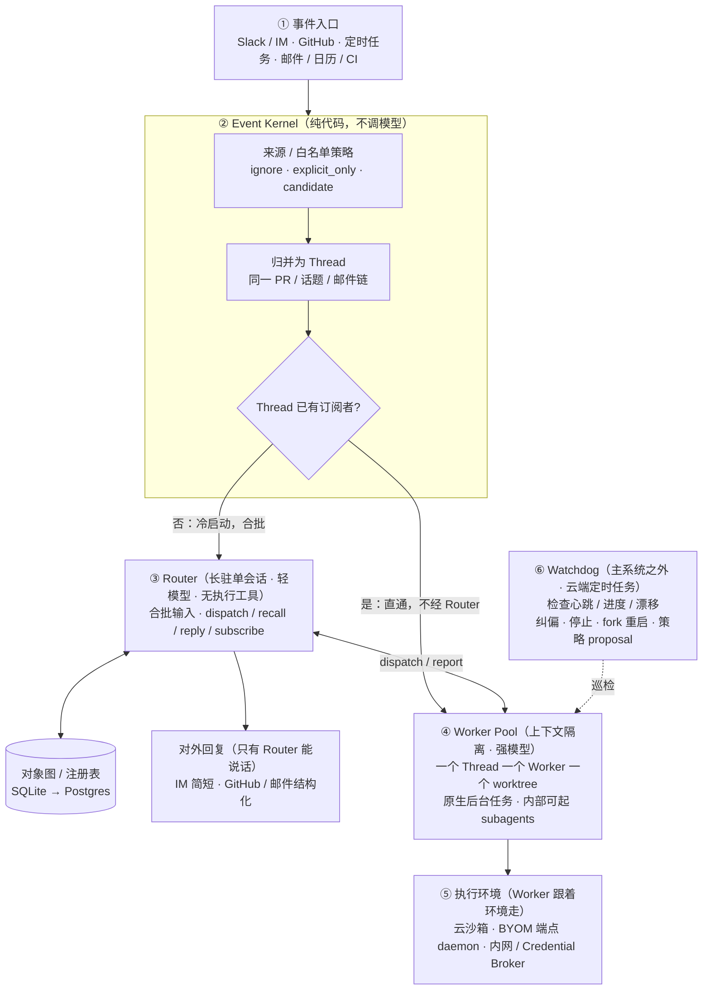
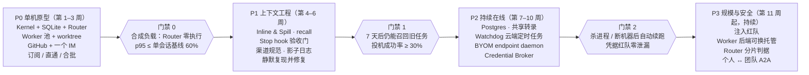

<!-- 来源与说明：
  快照自 Claude Docs《Claude Super Agent 落地方案》rev 17，2026-11-06 导出：https://claude.ai/artifact/SDway8Gszg9c8HHfyDryDU
  正文未改写，只做了两处机械处理：两张内嵌图按原标签重画为 Mermaid；去掉导出产生的下划线转义。
  文中能力说明核对于 2026-11-02。已知问题与未决事项见下方“读前须知”和 decisions.md。
-->

> **2026-11-12 补充：** 架构以 `docs/design/lane-coordinator-topology.html`（拓扑 v3）为准，用户已认可大方向。本文和它冲突的地方以拓扑为准，例如 Router 和 Worker 都是 `claude -p` 子进程这一条。详见 `decisions.md`。
>
> **读前须知（2026-11-06 整理时添加，不属于原文）**
>
> - 这是开发蓝图，不是已验证的结论。第 14.3 节的待验证项都还没跑过。
> - **未决：** 文档按 Slack 写 P0 IM，但文档里“先接哪个 IM”的评论还没有回复。这份方案也只考虑 Claude Code，尚未吸收 11-04 的跨厂商调研。见 `decisions.md`。
> - **第 4.2 节笔误：** 标题写“五个工具”，实际是 6 个工具名（`subscribe` 和 `unsubscribe` 合在一行）。第 11.5 节列全了。
> - **第 9.1 节依赖未验证项：** 第三层 `PreToolUse` 围栏要求 `--bare` 下 `--settings` 传入的 hook 仍然执行。第 14.3 节还没验证，也没有写明失败时的替代方案。第 11.3 节的启动命令用到了同样的组合。
> - **Watchdog 的连接路径没有写明：** 第 10 节让云端 Watchdog 读注册表和转录、给 Worker 发消息，但没有说明它如何连到 Kernel 主机上的数据。Kernel 主机挂掉时它能看到什么，也没有定义。动工 P2 前要补上（这是整理时的判断）。

# Claude Super Agent 落地方案

Nov 2, 2026 · @Ziqi Lau · v1 合并稿

基于 DeepSeek Harness 团队《Exploring Super-agent Design》的五模块架构，合并两份独立方案（施工图 + 能力勘探），面向 Claude Code CLI / Agent SDK 的完整实施计划。

## 1. 目标与范围

目标：把 Claude Code 从"一个等待指令的终端会话"变成一个持续在线、同时推进多个任务、主动响应环境事件的协作者。瓶颈不再是单任务的模型能力，而是人的注意力——一个人只能盯 3–5 个活跃会话，系统要把会话管理和上下文同步这件事接过去。

**四个验收特征**（来自原文，作为 P2 的验收目标）：

| 特征 | 含义 | 可观测的验收方式 |
| --- | --- | --- |
| Continuous | 用户在 IM、GitHub 任何入口对话，感觉始终是同一个 agent；在 IM 说方案 A、在 PR 里改成 B，agent 能跟上 | 跨渠道改需求测试：10 个用例中 ≥ 9 个正确切换 |
| Productive | 多任务并行、各自高质量；上一个任务没完就能接下一条指令 | 合成负载下任务完成时间 p95 ≤ 单会话基线的 60% |
| Proactive | 监听环境事件，值得处理就动手，否则保持安静 | 群聊中未被 @ 的 bug 讨论，能静默复现并交付修复 PR；误报率 < 1 次/天 |
| Persistent | 永远在线，连接真实工作环境，异常自恢复 | 杀掉任意进程 / 断开用户机器后，任务在 10 分钟内自动续跑 |

**范围内**：软件研发协作场景（issue 复现、PR review 响应、功能开发、CI 失败处理），接入 GitHub + 一个 IM；1–10 人团队规模；单个 Super Agent 实例。

**非目标**（本期不做）：Router 分片；跨实例 A2A 通信；替代 Claude Code 内核或 agent loop；个人助理场景（邮件/日历）只预留适配器接口；长期记忆（运行数月后的记忆问题，原文 8.1）。

**两份原始方案的分工**：方案甲（`cc-superagent`）提供了 Event Kernel 代码骨架、SQLite 引用图、Credential Broker、投机执行协议等施工细节；方案乙提供了对 Claude Code 现有能力的逐项核实、hooks 作为确定性围栏、Watchdog 独立性、生命周期约束和评估闭环。本方案以甲的工程结构为骨，用乙的核实结果纠偏，合并为一份。

## 2. 总体架构



事件从上往下流：入口适配器把所有来源归一化为 Trigger；Event Kernel 用纯代码过滤、归并、查订阅；已订阅的事件直通 Worker，未订阅的合批送给 Router；Router 派发、Worker 执行、Router 统一回复；Watchdog 在主系统之外定时巡检。

**两条设计铁律**（来自原文 7.1 的实验结论）：

1. **Router 不是"不愿意"执行，而是"不能"执行**。单会话 + subagent 工具在中性提示下 5 次运行 0 次委派，p95 29.5 分钟；两层架构 p95 15.7 分钟。区别不在提示词，在于 Router 根本没有 Bash/Edit/Agent 工具。实现上用三层围栏（第 9 节）。
2. **直通不提速，但省 Router 的 token**。去掉直通后 Router 决策次数多 30%、cache-read token 多 37%。所以订阅表和直通是 P0 就要有的，不是优化项。

**与 Claude Code 原生能力的对应**：全双工（后台 Bash、后台 subagent、Monitor）、会话持久化与 resume/fork、hooks 确定性围栏、worktree 隔离、跨会话 SendMessage、云端定时任务都是现成的；要自建的只有 Event Kernel、订阅/直通路由、合批队列、引用图和 Watchdog 的判断逻辑。

## 3. 事件入口与 Event Kernel

Event Kernel 是一个 Node.js/TypeScript 守护进程（目标 < 1500 行），是系统里唯一不调模型的核心：所有事件先经过它，90% 以上的噪声在这里以毫秒级、零 token 的成本丢掉。

### 3.1 入口适配器

每个来源一个适配器，输出统一的 `Trigger` 结构；适配器之外的代码不知道事件来自哪里。几个来源里有三个还是 research preview（Channels、云端定时任务、agent view），隔离在适配器里变了只改一处。

| 来源 | 接入方式 | thread_key 规则 | 备注 |
| --- | --- | --- | --- |
| GitHub | GitHub App webhook（issues / PR / review comment / check_run） | `gh:<owner>/<repo>#<number>` | P0 必做；`@claude` 同步场景可继续用官方 GitHub Action |
| Slack | Team/Enterprise 用 Claude Tag 做门面；否则自建 Slack app 订阅 Events API | `slack:<channel>:<thread_ts>` | P0 二选一 |
| Telegram / Discord | Claude Code Channels 插件（`claude --channels plugin:telegram@...`） | `tg:<chat_id>:<topic>` | 需 claude.ai 或 Console 鉴权 |
| 定时 / 外部系统 | 云端 scheduled task 的 API fire 端点（POST `/fire`，可带 text） | `cron:<task>` | 最小间隔 1 小时；更高频用 Kernel 内置定时器 |
| 邮件 / 日历 / CI | MCP connector 轮询或 webhook | `mail:<message_id_root>` / `ci:<run_id>` | P1 以后 |
| 系统内部 | Worker 的 report、后台任务完成、端点上线心跳 | 归入所属 Worker 的 Thread | 内部事件和外部事件走同一条管道 |

Trigger 结构：`{id, source, thread_key, author, ts, summary(≤120字), refs[], raw_ptr}`。`raw_ptr` 指向落盘的全文，全文不进模型上下文。

### 3.2 Fast Path 过滤（纯代码）

按来源配置三档策略，YAML 配置，热加载：

- `ignore`：直接丢弃（例：CI `status: pending`、非白名单 bot 消息、表情回应）
- `explicit_only`：只有显式 @ 或命令前缀才放行（例：公共大群）
- `candidate`：放行为候选事件，交给 Router 做语义判断（例：研发群、PR review 评论、CI failure）

再加三个通用规则：按 `(source, external_id)` 去重；每个 Thread 每分钟最多 N 条进入慢路径（防刷屏）；自己发出的消息不回流。

### 3.3 Thread 归并与订阅路由

同一 PR、同一 IM 话题、同一邮件链的连续事件归并为一个 Thread。订阅表 `subscriptions(thread_id, worker_id, role)` 是多对多：一个 Worker 可以订阅它的 IM 话题 + 它开的 PR + 仓库主干事件流；一个 PR 可以有两个 Worker 同时订阅。

路由逻辑只有两条：

1. **有订阅者 → 直通（Fast Path）**：写入每个订阅 Worker 的 inbox。Worker 进程活着就从 stdin 送入；不活着就 `claude -p --resume <session_id>` 拉起。Router 不参与。
2. **无订阅者 → Router（Slow Path）**：进入合批队列。

**影子日志**：直通事件不唤醒 Router，但在注册表里记一笔；下次 Router 因其他事件被唤醒时，合批消息末尾附一行 `[pass-through] trig_902 → wrk_108 @ gh:org/repo#42`。Router 用一行文本的代价保住全局态势。

**多 Worker 冲突自消解**：两个 Worker 改同一个模块时，它们都订阅了 `repo:main` 事件流；A 提交了公共接口改动，B 会收到同一事件，自己 rebase 或上报冲突。不需要 Worker 间点对点通信，也不需要 Router 协调。

### 3.4 合批队列

合批必须在 Kernel 做，不能指望会话层：Agent SDK 的流式输入是"排队、逐条顺序处理"，不会把积压消息合并成一轮。实现就是一把锁加一个数组：

- Router 空闲且新 Trigger 到达 → 立即送入，置 `busy`
- Router 忙 → Trigger 进 `pending[]`
- 收到 Router 输出流的 `result` 事件 → 置 `idle`，把 `pending[]` 全部打包成一条 user message 送入（每条 Trigger 带 id、thread、Inline 摘要）

这就是原文 2.1 的 Prefill 合批：长输入短输出，并行 prefill 让每次请求耗时增长远慢于批量大小。原文实测：Trigger 到达率从 1/分钟升到 40/分钟，均摊每个决策的推理时间从 6.4 秒降到 1.6 秒。配合 1 小时 prompt cache，Router 的长前缀几乎全是 cache read。

## 4. Router Session

Router 是一个长驻的单会话，用轻模型，只做两件事：和人说话、把任务派给 Worker。它没有 Bash、Edit、Write、Agent 工具，所以永远不会被一个 5 分钟的构建卡住，也不会"觉得任务小就自己做了"。原文的经验是 Router 的工作比预想简单，轻模型够用。

### 4.1 启动方式

两种实现二选一，接口相同：

| 方式 | 命令 / API | 适用 |
| --- | --- | --- |
| CLI 子进程 | `claude -p --bare --input-format stream-json --output-format stream-json --verbose --model <轻模型> --system-prompt-file prompts/router.md --mcp-config router-mcp.json --tools "mcp__router__*" --disallowedTools "Bash,Edit,Write,Agent,Skill,WebFetch,WebSearch" --session-id <uuid>` | P0 首选：与 Kernel 通过 stdio 对接，调试直观 |
| Agent SDK | `ClaudeSDKClient` + `AsyncIterable` 流式输入，`mcp_servers` 挂进程内工具，`resume` / `fork_session` | P2：Kernel 和 Router 同进程，少一层序列化，有 `interrupt()` |

`--bare` 跳过 hooks、skills、CLAUDE.md、auto memory、插件和默认 MCP，Router 的固定前缀只剩系统提示和 5 个工具定义。`--system-prompt-file` 整体替换默认系统提示，因为 Router 不需要那套写代码的指导。

### 4.2 五个工具（router-mcp）

| 工具 | 参数 | 行为 |
| --- | --- | --- |
| `dispatch_worker` | `thread_id, goal, mode(normal\|speculative), ttl_minutes?, env_hint?` | 建 worktree、起 Worker、写订阅；返回 `worker_id` |
| `send_to_worker` | `worker_id, message` | 跨任务协调的少数情况（例：用户在 IM 改了需求，PR 里的 Worker 要知道） |
| `recall` | `id?` 或 `query?` | 返回对象摘要 + 下一跳对象 id（第 6 节） |
| `reply` | `channel, thread_id, text, needs_decision?` | 经 Channel Formatter 校验后发出；超长直接拒绝并返回原因 |
| `subscribe` / `unsubscribe` | `thread_id, worker_id` | 维护订阅表；Worker 也能自己调 |

没有 `cancel_worker`——取消是通过 `send_to_worker` 让 Worker 自己收尾并 report，强杀只给 Watchdog。

### 4.3 系统提示的四个部分

1. 角色与红线：只交互和派发；不拆解任务；不评价 Worker 的代码。
2. 语义策略（`prompts/semantic-policies.md`，可热更新）：哪些候选事件值得处理、什么情况走投机执行、什么情况保持安静。这是原文 3.1 说的"自然语言扩展点"。
3. 渠道规范：IM ≤ 100 词 / 150 汉字，只在需要拍板、澄清、交付时开口；GitHub / 邮件结构化。
4. 上下文协议：收到的是 Inline 包，全文要 `recall`；合批消息里每条 Trigger 独立判断；影子日志只读不回。

### 4.4 上下文与生命周期

- **注入**：Trigger 只给 id + 摘要 + 相邻对象 id（第 6 节的 Inline & Spill）。
- **压缩**：`PreCompact` hook 把 Router 当前的活跃任务索引（worker_id → goal → thread）写入注册表；`SessionStart(matcher: compact)` hook 用 `additionalContext` 回灌这份索引。压缩丢的是细节，索引不丢，细节靠 `recall`。注意 `--bare` 会跳过 hooks，所以 Router 的 hooks 要通过 `--settings router-settings.json` 显式传入。
- **重启是常态**：`-p` 进程的无人值守上限是 30 分钟（最高可设 2 小时），空闲 10 分钟退出。Kernel 把 Router 进程退出当作正常事件：下一条 Trigger 到达时 `--resume <session_id>` 重新拉起，对话从 JSONL 续上。上下文损坏或进入异常循环时，`--fork-session` 从最后一个正常点分叉出新会话。
- **模型**：Haiku 5.5 起步，合成负载上测派发准确率不达标再升 Sonnet 5.5。原文 8.1 提到针对 Router 工作训练模型，我们做不到，但可以用 few-shot 的派发样例补。
- **分片**：不做。原文 7.2 的压测说明单 Router 在 40 事件/分钟下仍未到瓶颈；分片的代价是全局上下文被切开。触发分片的判据写在第 12 节 P3。

## 5. Worker Pool

一个 Thread 一个 Worker 一个 worktree。Worker 用最强的模型、全套工具，但从不直接面对人：它的推理和工具调用全部留在自己的会话里，只通过 `report` 把结论交给 Router。

### 5.1 启动参数

```bash
claude -p \
  --input-format stream-json --output-format stream-json --verbose \
  --session-id <uuid> \
  --worktree wrk-<thread-slug> \
  --model <强模型> \
  --permission-mode acceptEdits \
  --max-turns 200 --max-budget-usd 20 \
  --append-system-prompt-file prompts/worker-contract.md \
  --mcp-config worker-mcp.json \
  --settings worker-settings.json \
  --agents agents/workers.json
```

要点：

- `--worktree` 在 `<repo>/.claude/worktrees/<name>` 建独立工作树；`-w #123` 或 PR URL 可直接从该 PR 分支开。
- `--permission-mode acceptEdits` 自动批准文件编辑；需要更开放的用 `auto`，不用 `bypassPermissions`。危险命令由 `PreToolUse` hook 拦截（第 9 节）。
- `--max-turns` 和 `--max-budget-usd` 是内层护栏，到上限会出错退出，Kernel 收到后以 `BUDGET_EXCEEDED` 上报 Router。
- Worker 不用 `--bare`：它需要 CLAUDE.md、项目 hooks 和 skills。

### 5.2 Worker 契约（worker-contract.md）

1. 你不直接对人说话。所有需要人知道的事通过 `report(status, summary, needs_decision?, artifacts?)` 上报。
2. `status` 取值：`PROGRESS`、`BLOCKED`（附 needs_decision）、`DONE`、`DISCARD`、`SPECULATIVE_SUCCESS`、`SPECULATIVE_ABORT`、`HANDBACK`（事件超出任务范围，退回 Router 重新派发）。
3. 你订阅的 Thread 有新事件时，它会以 user message 形式到达，带 `[pass-through]` 前缀。和当前任务无关的调 `unsubscribe` 或 `handback`。
4. 长命令用 `run_in_background: true`，不要前台等。
5. 完成前必须运行项目的测试和 lint；这条由 Stop hook 强制，不是建议。
6. PR 描述按项目模板写全：问题背景、改动、验证结果、关联的 Thread 引用。

### 5.3 全双工：用原生能力，不自建

方案甲打算自建 `async_exec_start/stop` MCP 来解决"长命令卡住会话"。不需要：Claude Code 原生的 `Bash` 有 `run_in_background: true`，立即返回任务 ID，输出落文件，`TaskStop` 停止，`Monitor` 流式盯输出；前台命令超时会自动转后台；`-p` 进程会为后台任务保持存活。subagent 也默认后台运行，完成后以通知形式在下一轮送达。

自建一套会丢掉这些集成，且模型要学两套执行工具。真正要自己解决的只有"中途打断"：流式输入的新消息在当前轮结束后处理，要立即打断用 SDK 的 `interrupt()`（CLI 路径下的 control 消息待验证，见第 14 节）。

### 5.4 Stop hook 验收门

Worker 的 `worker-settings.json` 配置 `Stop` hook：运行项目测试 + lint，失败则返回 `{"decision":"block","reason":"<失败摘要>"}`，Worker 继续修；连续 3 次 block 后 hook 放行并让 Worker 以 `BLOCKED` 上报。`SubagentStop` 同理。这是"测试绿了才算完成"的系统保证，不依赖提示词。

`PostToolBatch` hook 做本地死循环检测：最近 5 次工具调用同命令同错误 → 注入 `additionalContext` 提醒换路；10 次 → exit 2 停止循环，由 Watchdog 接手。

### 5.5 内部结构与生命周期

- 复杂任务内部用 subagents（`agents/workers.json` 定义 reviewer、test-writer 等，`isolation: worktree`）。**不用 agent teams**：它是实验性且仅支持交互式，`-p` 和 SDK 不会起 teammate。嵌套深度默认 3，并发上限 20。
- **会话常驻、进程可重启**：Worker 的生命周期不是一个长跑进程。没事干就退出；订阅的 Thread 来了新事件就 `--resume` 拉起。状态全在 JSONL 和注册表里。这就是原文第 5 节的计算/状态分离，不需要额外机制。
- Worker 状态机：`CREATED → RUNNING → IDLE（进程退出，会话在）→ RUNNING … → DONE / DISCARDED / FAILED`，外加 `WAITING_FOR_ENDPOINT`（第 8 节）。
- 可选：用 agent view（`claude --bg`、`claude agents --json`）做进程池的可观测性，它给出 `working | blocked | done | failed | stopped` 状态，`Notification` hook 会在 `agent_needs_input` / `agent_completed` 时触发。还是 research preview，P2 再评估。

## 6. Reference Graph 与上下文组织

把上下文窗口当缓存：马上要用的内联（Inline），超出预算或很少用的落盘只留指针（Spill）。系统里所有对象有全局唯一 id，注入时顺带相邻对象的 id，模型沿着 id 一跳一跳地把上下文找回来（Chain of Recall）。原生 compaction 会把早期对话压成笼统摘要，PR 号、分支名这类细节会丢，所以长期记忆不能靠会话历史，要靠这张图。

### 6.1 数据表（SQLite 起步，P2 迁 Postgres）

| 表 | 关键字段 | 说明 |
| --- | --- | --- |
| `triggers` | `id, thread_id, source, author, ts, summary, raw_path` | 每条进入系统的事件，全文在 `raw_path` |
| `threads` | `id, thread_key, channel, title, latest_summary, updated_at` | 外部对话流的归并单位 |
| `workers` | `id, session_id, thread_id, goal, mode, state, worktree, endpoint, budget_used, last_heartbeat, result_summary` | 一个 Worker 一行；`session_id` 是 Claude Code 会话 id |
| `subscriptions` | `thread_id, worker_id, role` | 多对多 |
| `edges` | `src_id, dst_id, relation` | `trig → thd → wrk → thd(PR)` 的引用图 |
| `reports` | `id, worker_id, status, summary, ts` | Worker 上报的流水 |
| `spills` | `id, owner_id, path, bytes, head, tail` | 被截断的长内容 |
| `fts` | FTS5 虚表，索引 `summary`、`title`、`goal` | `recall(query=...)` 的入口 |

### 6.2 Inline 包格式（注入 Router / Worker 的每条 Trigger）

```json
{
  "trigger": "trig_2048",
  "thread": "thd_im_dev_01",
  "from": "alice",
  "preview": "前 120 字…",
  "full": "spill://trig_2048 (4,200 字，recall 可读)",
  "nearby": {
    "reply_to": {"id": "trig_2041", "preview": "…"},
    "adjacent": ["trig_2046: …", "trig_2047: …"],
    "linked": ["wrk_019 (RUNNING: 修复登录鉴权超时)", "thd_gh_pr_88"]
  }
}
```

局部性规则：先给当前对象的 id + 摘要；再给紧密相关对象的 id；再给时空相邻的内容（回复的那条、前后 2 条、同一 review 讨论的邻近评论）。超过预算的部分截断留指针。

### 6.3 工具输出的 Spill

用 Claude Code 的 `PostToolUse` hook：工具返回超过 2,000 字符时，hook 把全文写入 `.superagent/spills/<uuid>.txt`，用 `updatedToolOutput` 把返回替换为首尾各 600 字符 + `spill://<uuid> (共 N 字符，Read 可读，支持 offset)`。巨型构建日志不再擑爆窗口。这是 Claude Code 比 DSH 顺手的地方：Spill 是一个 hook，不是一层工具包装。

### 6.4 recall 协议与 Chain of Recall

`recall(id)` 返回：该对象摘要 + 它的下一跳对象（id + 一行摘要）。`recall(query)` 走 FTS5，返回最匹配的 5 个对象及其下一跳。每次 recall 的返回也遵守 Inline & Spill。

例：用户在 IM 问"上周那个鉴权 PR 改得怎么样了"。Router 调 `recall(query="鉴权")` → 命中 `thd_gh_pr_88`，内联下一跳 `wrk_019`、`trig_1024` → `recall("wrk_019")` → 拿到 `result_summary` 和最近一条 report。两跳回答，不翻历史对话。

### 6.5 与原生上下文机制的配合

| 原生机制 | 怎么用 |
| --- | --- |
| 自动 compaction | 保留默认；`PreCompact` hook 先把活跃对象索引写入注册表 |
| `SessionStart(matcher: compact)` | 用 `additionalContext` 回灌索引（上限 10,000 字符） |
| auto memory（`~/.claude/projects/<project>/memory/MEMORY.md`） | Worker 的项目级经验（构建坑、仓库惯例）。注意它是机器本地的，不跨云环境，`autoMemoryDirectory` 可指到共享卷 |
| CLAUDE.md | 仓库规范，压缩后不丢 |
| `/compact <focus>` | Watchdog 可对跑偏的 Worker 下达带焦点的压缩 |

长期记忆（运行数月后）是原文 8.1 承认的未解问题，本方案也不解决；引用图 + FTS5 覆盖的是"最近几周的任务可按需找回"。

## 7. 多渠道输出与投机执行

只有 Router 能对外说话，说什么、说多长由渠道决定；投机执行让系统在没人开口前就把活干了，干成了才说。

### 7.1 渠道规范与 Channel Formatter

`reply` 工具在发出前经过 Kernel 的 Channel Formatter，提示词和代码双重执行：

| 渠道 | 规范 | 代码侧强制 |
| --- | --- | --- |
| IM（Slack / 飞书 / Telegram） | 只在需要拍板、澄清歧义、交付结论时发言；结论在前；不播报"我正在读某文件" | ≤ 100 英文词 / 150 汉字，超长拒绝并让 Router 重写；同一 Thread 10 分钟内最多 1 条非应答消息 |
| GitHub PR / Issue | 结构化：问题背景、根因、改动文件、验证结果、关联 Thread | 按项目 PR 模板校验必填段；评论回复引用原评论 |
| 邮件 / 文档 | 信息密度高，可长 | 无长度限制；附来源引用 |
| 运维群（Watchdog 专用） | 异常、proposal、需要人批准的动作 | 每条带 worker_id 和建议动作 |

Worker 的推理过程和工具日志全部留在本地转录，任何渠道都看不到。这是两层架构自动带来的，不需要额外过滤。

### 7.2 投机执行（Acting Ahead）

策略例："静默复现并修复"。群里有人讨论疑似 bug 但没人指派，Router 按语义策略调 `dispatch_worker(mode="speculative", ttl_minutes=15)`。

协议：

1. 投机 Worker 在独立 worktree 里复现 → 修复 → 跑测试；预算比普通 Worker 小（例：`--max-budget-usd 5`、`--max-turns 60`）。
2. TTL 到、预算到、复现失败、改动超过阈值（例：> 5 个文件或 > 200 行）：`report(SPECULATIVE_ABORT)`，Kernel 删 worktree，Router 全程不发言。
3. 复现成功且 Stop hook 验收通过：推分支、开草稿 PR，`report(SPECULATIVE_SUCCESS, artifacts=[pr_url])`。Router 在群里发一条 ≤ 100 词的提示 + PR 链接。
4. 若讨论期间有人明确说"不用修"，该事件通过订阅直通投机 Worker，它自己 ABORT。

这个模式用额外的后台算力换人的等待时间。P1 要量的指标：投机成功率、每次成功的平均花费、被人接受（PR 合并）的比例。成功率低于 30% 就收紧触发策略，不要硬撑。

## 8. 计算 / 状态 / 环境分离与 BYOM

三样东西分开放：跑 agent loop 的计算是无状态的，可以随时重启；会话和注册表是状态，放持久化存储；代码库、本地工具链、未提交改动、内网服务是环境，留在原地。

### 8.1 状态在哪里

| 状态 | 位置 | 说明 |
| --- | --- | --- |
| 对象图 / 注册表 / 订阅 | SQLite（P0）→ Postgres（P2） | Kernel 的唯一真相源 |
| 会话转录 | `~/.claude/projects/<cwd>/<session-id>.jsonl`；`CLAUDE_CONFIG_DIR` 指到共享卷，或 SDK `session_store` 适配器 | 任何机器都能 `--resume` |
| Spill 文件 | 对象存储或共享卷 | 按 owner_id 分目录 |
| auto memory | 每台执行机器本地，`autoMemoryDirectory` 可集中 | 云环境里默认没有 |
| 策略文件 | git 仓库（`prompts/`、`policies/`） | 改动走 PR，Watchdog 只能提 proposal |

### 8.2 计算在哪里

- Kernel + Router：一个常驻容器（P0 可以就是一台 7×24 的小机器 + systemd）。容器重启后 Router `--resume`，没有东西丢。
- Worker：按需拉起的进程，跑在任务需要的环境里（下一节）。
- Watchdog：云端 scheduled task，不在 Kernel 的机器上。

### 8.3 环境：Worker 跟着环境走

原文的做法是 agent loop 在云端、端点装轻量 daemon 执行命令。方案甲照搬了这个结构，但让 Worker 用原生 Read/Edit/Bash 操作 Kernel 主机的 worktree、用 "Remote Env MCP" 操作远端机器——模型面对两套文件系统和两套 shell，容易搞混在哪台机器上。

Claude Code 特有的简化：CLI 本来就是设计成跑在代码所在机器上的。所以 **Worker 进程直接跑在环境所在的机器上**，Kernel 通过隧道以 stream-json 和它对话，会话文件落共享存储。模型只看到一套文件系统。计算跟着环境走，状态跟着数据库走。

| 环境类型 | Worker 在哪里跑 | 接入方式 |
| --- | --- | --- |
| 云沙箱（无特殊依赖的仓库） | Kernel 同主机的容器，或 Claude Code cloud session（`claude --cloud`） | P0 默认 |
| BYOM：用户开发机 / GPU 工作站（未提交改动、本地凭据、特定硬件） | 该机器上的 `superagent-endpoint` daemon，收到指令后本地 `claude -p --resume` | Tailscale / WireGuard 隧道；daemon 无状态，只负责拉起进程和转发 stdio |
| 内网（Team/Enterprise） | 官方 self-hosted environment runner | 这是文档化的"云端会话在你的基础设施上执行"的方式；推理仍只走 api.anthropic.com |
| 托管（P3 可选） | Managed Agents Session + Environment | Agent / Environment / Session / Events 四个概念与本方案一一对应，可整体替换 Worker 后端 |

### 8.4 端点离线：WAITING_FOR_ENDPOINT

任务的 `env_hint` 指向某台用户机器而它不在线（笔记本合盖）：Worker 状态置 `WAITING_FOR_ENDPOINT`，事件在 inbox 里累积。daemon 重连时发心跳事件，Kernel 把这台机器上所有等待的 Worker 依次 `--resume`。Router 在用户问起时能从注册表看到"等你的机器上线"，如实回答。

这是一个状态机里的正常状态，不是异常；Watchdog 对处于该状态的 Worker 不报警，只在等待超过 24 小时时提醒。

### 8.5 两个官方能力的边界

- Remote Control（`claude --rc`）是用手机/浏览器驱动本地会话，方向和 BYOM 相反，不是本方案的组件。
- 本次讨论所在的会话就是"云端 loop + 本机 daemon"的 BYOM 形态，说明这条路在产品里已经走通；但它是桌面应用的能力，不是可编程原语，所以我们自己写 endpoint daemon。

## 9. 安全设计

事件驱动意味着更多不可信输入进入模型上下文；连接用户机器意味着一次注入可能波及所有端点。原文 8.4 的结论是：这个问题不解决，Super Agent 只能在很小的信任范围内用。本方案用四道防线。

### 9.1 第一道：Router 没有执行工具（三层围栏）

所有外部输入首先到达 Router，而 Router 执行不了任何东西：

1. `--tools "mcp__router__*"` 白名单：只暴露 5 个 MCP 工具。
2. `--disallowedTools "Bash,Edit,Write,Agent,Skill,WebFetch,WebSearch"` 兜底（`--allowedTools` 只是自动批准，不限制，不要用它做围栏）。
3. `PreToolUse` hook：任何非 `mcp__router__*` 的调用返回 `permissionDecision: deny`。

三层任一失效其他两层仍在。这比提示词里写"不要自己执行"可靠得多。

### 9.2 第二道：Worker 的 hooks 围栏（worker-settings.json）

| Hook | 规则 | 动作 |
| --- | --- | --- |
| `PreToolUse` (Read/Grep/Glob) | 路径匹配 `*.pem`, `.env*`, `*secret*`, `~/.ssh/*`, `~/.aws/*` | deny |
| `PreToolUse` (Bash) | 命令包含 `curl ... \| sh`、`rm -rf /`、`git push --force` 到保护分支、读取凭据文件 | deny，附 reason |
| `PreToolUse` (Bash) | 命令含 `$CRED_*` 占位符 | `updatedInput` 改写为经 Credential Broker 执行（下节） |
| `PostToolUse` (所有) | 输出匹配凭据正则 + 高熵字符串 | `updatedToolOutput` 替换为 `<REDACTED>` |
| `PostToolUse` (所有) | 输出 > 2,000 字符 | Spill（第 6 节） |
| `UserPromptSubmit` | `[pass-through]` 消息中含疑似注入模式（"ignore previous"、要求读取凭据、要求改策略文件） | 注入 `additionalContext` 标记为不可信；高危模式直接 block |
| `Stop` / `SubagentStop` | 测试 / lint 未通过 | block + reason（第 5 节） |
| `PostToolBatch` | 死循环模式 | 提醒 → 停止 |

外加 Claude Code 自带的沙箱（`/sandbox`）和域名白名单，Worker 容器只能访问包管理器、GitHub 和 api.anthropic.com。

### 9.3 第三道：Credential Broker——用凭据但看不见凭据

来自方案甲，是原文 8.4 "the agent needs a way to use credentials without ever seeing them" 的完整实现：

1. `.env`、API key、SSH 私钥、云厂商 token 不出现在 Worker 可读的任何目录。
2. 需要认证的命令（`gh`、`aws`、数据库迁移）只写占位符：`psql $CRED_PROD_DB_URL -c ...`。
3. `PreToolUse` hook 把命令改写为 `superagent-cred-exec --allow CRED_PROD_DB_URL -- <原命令>`；该二进制在端点 daemon 的进程环境里注入真实值执行。哪些占位符对哪些命令可用，由 `policies/credentials.yaml` 白名单决定。
4. `PostToolUse` hook 对输出做正则 + 熵扫描脱敏。

即使外部事件成功注入，攻击者也拿不到明文密钥：它从没进过模型上下文。

### 9.4 第四道：Watchdog 的权限边界

Watchdog 读的是 Worker 转录，里面全是不可信内容。方案甲让它直接改 `semantic-policies.md` 和 Fast Path 配置，这是注入攻击的最短路径。本方案限制为：

- 可以：只读巡检、`SendMessage` 纠偏、`TaskStop`、`--fork-session` 重启、向运维群发消息。
- 不可以：直接写策略文件。策略变更以 PR 形式提 proposal，人合并后 Kernel 热加载。
- 自然语言运维接口保留（"为什么 #42 卡住了"），但回答问题和执行变更是两件事。

### 9.5 信任范围的演进

P0–P1 只接入内部研发群和自己的仓库，所有事件来源都是已知成员。P2 做注入红队（在 PR 评论、issue 正文、提交信息里埋指令）通过后，再考虑开放公开 issue 跟踪器和外部贡献者的事件。

## 10. Watchdog

Watchdog 是主系统之外的独立控制环。它不在 Kernel 的机器上，不共享 Kernel 的进程，Kernel 挂了它还在。它监控的不只是进程存活，还有"模型是不是在原地打转"和"是不是偏离了目标"——这两种异常进程都在跑，传统存活探针看不出来。

### 10.1 跑在哪里、怎么触发

- 云端 scheduled task（Claude Code 的 routines）每小时触发一次，每次是全新会话——这正好符合"独立于主系统"。云端定时最小间隔是 1 小时。
- 更高频的存活检查（每 5 分钟）由 Kernel 内的纯代码定时器做：心跳超时就 `--resume` 重拉，连续 3 次失败就调云端任务的 API fire 端点立即触发 Watchdog。不需要模型的判断不要调模型。
- 方案甲用同主机的 cron，我们不用：主机挂了 cron 一起挂。

### 10.2 每次巡检做什么

Watchdog 会话只挂 `watchdog-mcp`（只读查注册表、读转录、发消息、停进程），没有 Edit/Write。

| 检查项 | 判断方式 | 阈值 |
| --- | --- | --- |
| 基础设施 | 注册表里 `last_heartbeat`、API 429/5xx 计数、`--resume` 失败记录 | 心跳 > 15 分钟且状态 RUNNING |
| 进度（原地打转） | 读最近 20 次工具调用摘要：同命令同错误重复、同文件反复改回 | 重复 ≥ 5 次 |
| 漂移（偏离目标） | 用模型比较 `task_goal` 与最近改动的文件/命令：是否在改无关模块、是否在做 goal 没要求的事 | 模型判定为漂移且置信度高 |
| 预算 | `budget_used` / `max_budget` | > 80% 且无 PROGRESS 上报 |
| 等待 | `WAITING_FOR_ENDPOINT` 时长 | > 24 小时提醒，不报警 |

### 10.3 动作清单（按升级顺序）

1. **纠偏**：跨会话 `SendMessage(worker_id, "你在 X 上循环了 5 次，回退并尝试 Y，或以 BLOCKED 上报"`）。Claude Code 的跨会话消息在工具调用之间送达，Worker 的 `crossSessionInbound` 设为 `accept`，但只接受 Watchdog 和 Router 的来源。
2. **带焦点压缩**：让 Worker 执行 `/compact 聚焦于 <goal>`，清掉跑偏的上下文。
3. **停止**：`TaskStop` 停掉失控的后台命令；终止 Worker 进程。
4. **重启**：`claude -p --resume <sid> --fork-session`，从最后一个正常 report 的位置分叉，原会话保留供事后分析。
5. **上报**：在运维群发一条，带 worker_id、诊断、已采取动作、建议。
6. **Proposal**：如果根因是策略问题（某类 CI 警告该忽略、某个群该改成 explicit_only），开一个改 `policies/` 的 PR，不直接改。

### 10.4 自然语言运维

维护者在运维群 `@watchdog 为什么 #42 的修复卡住了`，这条消息走 API fire 触发一次 Watchdog 会话，它读注册表和转录后回答。因为它自己是一个带工具的会话，诊断不需要预先写好的仪表盘。

### 10.5 内层护栏与外层控制环的分工

Worker 自己的 `--max-turns`、`--max-budget-usd`、`Stop` hook、`PostToolBatch` hook 是内层护栏，在进程内、零延迟。Watchdog 是外层，处理内层漏掉的和跨进程的问题。两层都要，内层不能替代外层：内层和被监控对象同生共死。

## 11. 代码骨架与配置清单

以方案甲的目录结构为底，去掉 `async-job-runner.ts`（原生后台任务替代），加上 endpoint daemon、策略目录和评估工具。

### 11.1 目录结构

```text
cc-superagent/
├── src/
│   ├── kernel.ts            # 事件入口、Fast Path、Thread 归并、订阅路由、合批
│   ├── adapters/            # github.ts · slack.ts · telegram.ts · cron.ts · internal.ts
│   ├── router-proc.ts       # Router 子进程：stdio 行缓冲、busy 锁、--resume 重拉
│   ├── worker-pool.ts       # worktree、Worker 进程池、inbox、状态机、端点路由
│   ├── endpoint-daemon.ts   # 装在用户机器上的无状态 daemon：拉起 claude -p、转发 stdio、心跳
│   ├── mcp/
│   │   ├── router-mcp.ts    # dispatch_worker · send_to_worker · recall · reply · subscribe
│   │   ├── worker-mcp.ts    # report · recall · subscribe · handback
│   │   └── watchdog-mcp.ts  # 只读查询 · send_message · stop · fork_restart · open_proposal
│   ├── graph/db.ts          # SQLite schema + FTS5 + edges
│   ├── context/inline.ts    # Inline 包构造器、局部性规则
│   ├── channels/format.ts   # Channel Formatter
│   └── eval/synthetic.ts    # 复现论文 7.1 的合成负载
├── hooks/                   # 给 Worker 的 hook 脚本（spill.sh · redact.sh · deny-secrets.sh · verify-stop.sh · loop-guard.sh）
├── prompts/
│   ├── router.md            # 整体替换 Router 系统提示
│   ├── worker-contract.md   # 追加到 Worker 系统提示
│   └── watchdog.md
├── policies/
│   ├── fast-path.yaml       # 每个来源的 ignore / explicit_only / candidate
│   ├── semantic-policies.md # Router 的语义策略，热加载
│   └── credentials.yaml     # 占位符 → 允许的命令前缀
├── config/
│   ├── router-mcp.json · worker-mcp.json · watchdog-mcp.json
│   ├── router-settings.json · worker-settings.json
│   └── agents/workers.json  # Worker 内部 subagents（reviewer · test-writer）
└── package.json
```

### 11.2 Kernel 核心：路由与合批（TypeScript 切片）

```typescript
// src/kernel.ts — 在方案甲骨架上修正：行缓冲、影子日志、Router 重启容错
import { db } from './graph/db';
import { RouterProc } from './router-proc';
import { WorkerPool } from './worker-pool';
import { buildInline } from './context/inline';
import { fastPath } from './policies';

export class Kernel {
  private router = new RouterProc();        // 内部处理 stdout 行缓冲、result 事件、退出后 --resume
  private pool = new WorkerPool();
  private pending: Trigger[] = [];
  private shadow: string[] = [];            // 直通事件的影子日志，下次唤醒 Router 时附上

  constructor() {
    this.router.on('turn_end', () => this.flush());
  }

  async onEvent(raw: ExternalEvent) {
    const verdict = fastPath(raw);                       // 3.2：ignore / explicit_only / candidate
    if (verdict === 'ignore') return;
    const trig = await db.saveTrigger(raw);              // 全文落盘，表里只存摘要
    const subs = await db.subscribers(trig.thread_id);   // 3.3
    if (subs.length > 0) {
      for (const w of subs) await this.pool.deliver(w.id, buildInline(trig));   // 直通：stdin 或 --resume
      this.shadow.push(`[pass-through] ${trig.id} → ${subs.map(w => w.id).join(',')} @ ${trig.thread_key}`);
      return;
    }
    this.pending.push(trig);                             // 冷启动 → 合批队列
    if (this.router.idle) this.flush();
  }

  private flush() {
    if (this.pending.length === 0 && this.shadow.length === 0) return;
    if (!this.router.idle) return;
    const batch = this.pending.splice(0);
    const shadow = this.shadow.splice(0);
    const content = [
      `[BATCHED_TRIGGERS count=${batch.length}]`,
      ...batch.map(t => JSON.stringify(buildInline(t))),
      shadow.length ? `[PASS_THROUGH_LOG]\n${shadow.join('\n')}` : ''
    ].join('\n---\n');
    this.router.send({ type: 'user', message: { role: 'user', content } });   // RouterProc 置 busy，收到 result 后置 idle
  }
}
```

`RouterProc` 负责的细节：stdout 按 `\n` 切行再 `JSON.parse`（chunk 会把一行切开）；`type === 'result'` 触发 `turn_end`；子进程退出（无人值守上限、空闲退出、崩溃）时不报错，下次 `send` 前用同一 `session_id` `--resume` 重拉。

### 11.3 Router 启动命令（完整）

```bash
claude -p --bare \
  --input-format stream-json --output-format stream-json --verbose \
  --model claude-haiku-5-5 \
  --session-id "$ROUTER_SESSION_ID" \
  --system-prompt-file prompts/router.md \
  --mcp-config config/router-mcp.json --strict-mcp-config \
  --settings config/router-settings.json \
  --tools "mcp__router__*" \
  --disallowedTools "Bash,Edit,Write,Agent,Skill,WebFetch,WebSearch,NotebookEdit" \
  --max-turns 50
```

首次启动用 `--session-id`，之后每次重拉改用 `--resume "$ROUTER_SESSION_ID"`。

### 11.4 Worker hooks（config/worker-settings.json）

```json
{
  "hooks": {
    "PreToolUse": [
      { "matcher": "Read|Grep|Glob", "hooks": [{ "type": "command", "command": "hooks/deny-secrets.sh" }] },
      { "matcher": "Bash", "hooks": [{ "type": "command", "command": "hooks/guard-bash.sh" }] }
    ],
    "PostToolUse": [
      { "matcher": ".*", "hooks": [
        { "type": "command", "command": "hooks/redact.sh" },
        { "type": "command", "command": "hooks/spill.sh" }
      ] }
    ],
    "PostToolBatch": [
      { "hooks": [{ "type": "command", "command": "hooks/loop-guard.sh" }] }
    ],
    "UserPromptSubmit": [
      { "hooks": [{ "type": "command", "command": "hooks/mark-untrusted.sh" }] }
    ],
    "Stop": [
      { "hooks": [{ "type": "command", "command": "hooks/verify-stop.sh", "timeout": 600 }] }
    ],
    "SubagentStop": [
      { "hooks": [{ "type": "command", "command": "hooks/verify-stop.sh", "timeout": 600 }] }
    ],
    "PreCompact": [
      { "hooks": [{ "type": "command", "command": "hooks/snapshot-index.sh" }] }
    ],
    "SessionStart": [
      { "matcher": "compact", "hooks": [{ "type": "command", "command": "hooks/restore-index.sh" }] }
    ]
  }
}
```

关键脚本的返回约定：`deny-secrets.sh` 和 `guard-bash.sh` 输出 `{"hookSpecificOutput":{"hookEventName":"PreToolUse","permissionDecision":"deny","permissionDecisionReason":"..."}}`；`guard-bash.sh` 遇到 `$CRED_*` 时输出 `updatedInput` 改写命令；`spill.sh` / `redact.sh` 输出 `updatedToolOutput`；`verify-stop.sh` 失败时输出 `{"decision":"block","reason":"..."}`，成功时 exit 0 无输出。

### 11.5 MCP 工具清单

| Server | 工具 | 谁用 |
| --- | --- | --- |
| `router` | `dispatch_worker` · `send_to_worker` · `recall` · `reply` · `subscribe` · `unsubscribe` | Router |
| `worker` | `report` · `recall` · `subscribe` · `unsubscribe` · `handback` | Worker（与原生工具并存） |
| `watchdog` | `list_workers` · `read_transcript_tail` · `send_message` · `stop_worker` · `fork_restart` · `notify_ops` · `open_policy_proposal` | Watchdog |
| `endpoint`（daemon 协议，非 MCP） | `spawn(session_id, args)` · `stdin(line)` · `heartbeat` | Kernel ↔ 用户机器 |

三个 MCP server 都是同一个进程（`src/mcp/*`）的不同工具集，用 stdio 挂到对应会话；P2 改用 Agent SDK 时换成进程内 `create_sdk_mcp_server`，工具定义不变。

## 12. 分阶段路线图



每个门禁都是一个可度量的实验结果，不是"功能做完了"；过不了门禁不进下一阶段。方案甲的 4 周排期偏乐观；合并后的估算是 10–12 周到"持续在线"，其中 P0 第一周就要把合成负载跑起来。

| 阶段 | 交付物 | 验收指标 |
| --- | --- | --- |
| P0 单机原型（第 1–3 周） | Kernel（Fast Path、Thread、订阅、直通、合批）；SQLite 引用图；Router（三层围栏）；Worker 池 + worktree + report；GitHub webhook + 一个 IM；`eval/synthetic.ts` | Router 在 5 次合成负载中 0 次执行类工具调用；开/关直通对比 Router 决策次数下降 ≥ 25%；p95 ≤ 单会话 + subagent 基线的 60%；同进程多 SDK 会话可行性结论 |
| P1 上下文工程（第 4–6 周） | Inline 包构造器；`recall` + FTS5 + Chain of Recall；PostToolUse Spill/脱敏；PreCompact/SessionStart 索引；Channel Formatter；Stop hook 验收；影子日志；投机执行协议 | Router 连续跑 7 天后，20 个历史任务问答 ≥ 18 个正确召回；IM 回复超长率 0；投机成功率 ≥ 30% 且误报 < 1 次/天；Stop hook 拦截的"未测试就完成"比例有记录 |
| P2 持续在线（第 7–10 周） | Postgres；共享转录存储；Worker 按需 `--resume`；Watchdog 云端定时任务 + watchdog-mcp；endpoint daemon + `WAITING_FOR_ENDPOINT`；Credential Broker；运维群 | 随机杀 Kernel/Router/Worker 进程，任务 10 分钟内续跑；用户机器离线 2 小时再上线，等待任务自动完成；凭据红队（10 种注入话术）零明文泄漏；Watchdog 对人工制造的死循环 1 小时内纠偏 |
| P3 规模与安全（第 11 周起） | 提示注入红队常态化；Worker 后端适配 Managed Agents / cloud session；Router 合批饱和监控；个人 Super Agent 与团队实例的 A2A 协议草案 | 原文 8.1–8.4 每个开放问题有一个可度量实验；分片触发条件：平均批大小 > 6 且单次决策超时率 > 5% |

P0 选自托管（CLI 子进程 + SQLite）而不是 Managed Agents，因为可控、便宜、能本地跑；但 Router/Worker 的接口从第一天就定为与会话实现无关的 `dispatch / report / recall / subscribe`，P3 切后端不动上层。

## 13. 评估方案

没有合成负载就无法知道两层架构是否真的比单会话好。原文 7.1 的实验设计直接复现，`src/eval/synthetic.ts` 是 P0 第一周的交付物。

### 13.1 合成负载

- 一次运行约 300 条消息，其中约 20 条是工作请求，其余是闲聊、追问、取消、CI 消息。消息间隔和任务时长按 1/4 缩放，模型调用时间不缩放。
- "编码工作"用一个只消耗时间的 mock 工具模拟，测的是调度和协调，不是单任务能力。
- 每种设计跑 5 次。

### 13.2 对照组

| 设计 | 说明 | 原文结果（p50 / p95 分钟，cache-read token） |
| --- | --- | --- |
| Super Agent（完整） | 两层 + 订阅直通 | 12.4 / 15.7，23.2M |
| Super Agent 无直通 | 所有事件经 Router | 12.6 / 15.5，31.8M |
| 单会话 + subagent，中性提示 | "合适时用 subagent" | 20.4 / 29.5，6.1M（5 次运行 0 次委派） |
| 单会话 + subagent，委派优先提示 | "每条消息都到你这，优先交给 subagent" | 13.8 / 29.0，10.8M（5 次中 4 次委派） |

我们的基线就是后两行：一个普通 Claude Code 会话，所有事件以 user message 注入，分别用两种提示词。

### 13.3 指标定义

| 指标 | 定义 | 门禁 |
| --- | --- | --- |
| 任务完成时间 p50 / p95 | 从工作请求到其结果消息 | p95 ≤ 基线 60% |
| Router 执行次数 | Router 会话中非 `mcp__router__*` 的工具调用 | 0 |
| Router 决策次数 | Router 的 LLM 轮数 | 开直通比关直通低 ≥ 25% |
| cache-read token | 所有会话合计 | 记录，不设门禁；用于成本模型 |
| 平均批大小 / 单次请求耗时 / 均摊每决策耗时 | Router 压测（原文 7.2），Trigger 到达率 1 → 40 /分钟 | 均摊耗时随负载下降；这是分片判据的数据来源 |
| 误派发率 | 对闲聊 / 取消消息错误建 Worker | < 5% |
| 漏派发率 | 工作请求未建 Worker | < 5% |

### 13.4 非合成的验收（P1 起）

- 跨渠道改需求：10 个脚本（IM 说 A、PR 里改 B），正确切换 ≥ 9。
- 召回：Router 连续运行 7 天后问 20 个历史任务，≥ 18 个回答正确（对照注册表）。
- 投机执行：在真实研发群运行 2 周，记录成功率、每次成功花费、PR 合并率。
- 恢复：随机杀进程、断端点，测续跑时间。
- 安全：10 种注入话术埋在 PR 评论 / issue / 提交信息里，检查是否有明文凭据进入转录、是否有策略文件被改。

## 14. 风险、取舍与待验证清单

### 14.1 风险与对策

| 风险 | 影响 | 对策 |
| --- | --- | --- |
| Token 成本：多个长驻会话，cache-read 量大（原文 23.2M / 次运行） | 月度账单 | Router 用轻模型 + `--bare`；直通减少 Router 轮数；1 小时 prompt cache；P0 就记录每任务成本 |
| 多个 research preview 特性会变（Channels、云端定时任务、agent view） | 适配器返工 | 全部隔离在 `adapters/` 和 `worker-pool.ts`；核心路径（`-p`、hooks、`--resume`、worktree）都是正式特性 |
| `-p` 无人值守时限 30 分钟～2 小时，空闲 10 分钟退出 | 长任务被打断 | 设计为"会话常驻、进程可重启"；Kernel 把退出当常态 |
| agent teams 仅交互式 | Worker 内部不能用 team | 用 subagents（嵌套 3、并发 20 够用） |
| 安全面扩大 | 注入 → 端点被控 | 第 9 节四道防线；P0–P1 只接内部来源 |
| 单 Router 成为瓶颈 | 决策延迟上升 | 原文压测 40 事件/分钟未到瓶颈；分片判据写在 P3，不提前做 |
| Watchdog 误判漂移 | 打断正常工作 | 第一版只纠偏不重启；重启需连续两次巡检一致 |
| 方案甲的 4 周排期与本方案的 10–12 周 | 期望管理 | 门禁过不了不推进；P0 结束时重估 |

### 14.2 两份方案的取舍记录

| 议题 | 方案甲 | 方案乙 | 合并决定 |
| --- | --- | --- | --- |
| 长命令不阻塞 | 自建 async_exec MCP | 原生 run_in_background | 原生；打断用 `interrupt()` |
| Watchdog 位置 | 同主机 cron 每 5 分钟 | 云端定时任务 | 云端每小时 + Kernel 内纯代码 5 分钟存活检查 |
| Watchdog 改策略 | 直接改 | 未明确 | 只出 proposal，人合并 |
| Router 围栏 | `--disallowedTools` | `--tools` + hook | 三层都上 |
| Router 系统提示 | `--system-prompt-file` 替换 | `--append` | 替换 + `--bare` |
| 直通后 Router 的感知 | 影子日志 | 无 | 影子日志 |
| 凭据 | Credential Broker + 熵扫描 | hook 拒读 .env | 两者都要 |
| BYOM 执行面 | 本地 worktree + Remote Env MCP | 未展开 | Worker 进程跑在环境所在机器 |
| 验收 | 无 | 复现 7.1 实验 | 门禁制 |
| Stop hook 验收门 | 无 | 有 | 有 |
| 模型名 / 工具名 | 上一代（sonnet-4-5、Task） | 当前（Haiku/Sonnet 5.5、Agent） | 当前 |

### 14.3 待验证清单（P0 第一周）

- [ ] 同一进程内多个独立 Agent SDK 会话并发是否可靠（官方文档未承诺）；不行则一会话一子进程
- [ ] `--input-format stream-json` 的 NDJSON 行结构和中途打断的 control 消息（SDK `interrupt()` 已确认，CLI 路径待证）
- [ ] `-p` 无人值守时限是按会话还是按轮计算；对持续收到输入的 Router 子进程是否生效
- [ ] `PostToolUse` 的 `updatedToolOutput` 对 MCP 工具返回是否同样生效
- [ ] 带 `--bare` 时 `--settings` 传入的 hooks 是否执行
- [ ] Stop hook 运行测试的超时上限（文档未见；大仓库测试可能超过）
- [ ] 跨会话 SendMessage 对 `-p` 会话是否可达，`crossSessionInbound` 的来源过滤粒度
- [ ] 云端定时任务 API fire 端点的认证与限流（100 次/小时/账户）是否够 Watchdog 用
- [ ] 投机 Worker 的 PR 草稿权限：用什么身份推分支、开 PR

## 15. 参考资料

原文与两份原始方案：

- [DeepSeek Harness: Exploring Super-agent Design: Towards a More Autonomous Agent System](https://x.com/DeepSeekHarness/status/2116857257245987236)（2026-11-01；原型插件 dsh-superagent-prototype）
- 方案甲：`cc-superagent` 架构设想与工程规划（用户提供的附件）
- 方案乙：本会话中基于 Claude Code 能力核实的设想与规划

Claude Code / Agent SDK 官方文档（本方案引用的能力均于 2026-11-02 核对）：

- [Hooks](https://code.claude.com/docs/en/hooks) · [Hooks guide](https://code.claude.com/docs/en/hooks-guide)
- [CLI reference](https://code.claude.com/docs/en/cli-reference) · [Headless / -p](https://code.claude.com/docs/en/headless)
- [Agent SDK overview](https://code.claude.com/docs/en/agent-sdk/overview)
- [Subagents](https://code.claude.com/docs/en/sub-agents) · [Agent teams](https://code.claude.com/docs/en/agent-teams) · [Cross-session messaging](https://code.claude.com/docs/en/cross-session-messaging)
- [Channels](https://code.claude.com/docs/en/channels) · [GitHub Actions](https://code.claude.com/docs/en/github-actions) · [Claude Tag](https://claude.com/docs/claude-tag/overview)
- [Claude Code on the web](https://code.claude.com/docs/en/claude-code-on-the-web) · [Self-hosted environments](https://code.claude.com/docs/en/self-hosted-environments) · [Scheduled tasks](https://code.claude.com/docs/en/routines) · [Remote Control](https://code.claude.com/docs/en/remote-control)
- [Managed Agents](https://platform.claude.com/docs/en/managed-agents/overview)
- [Context window](https://code.claude.com/docs/en/context-window) · [Memory](https://code.claude.com/docs/en/memory) · [Sessions](https://code.claude.com/docs/en/sessions) · [Worktrees](https://code.claude.com/docs/en/worktrees)
- [Tools reference](https://code.claude.com/docs/en/tools-reference) · [Agent view](https://code.claude.com/docs/en/agent-view) · [Plugins components](https://code.claude.com/docs/en/plugins/components) · [Skills](https://code.claude.com/docs/en/skills)
